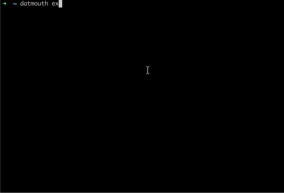

# datmouth

P2P chat client for the terminal, for ephemeral conversations. Built on the
[Holepunch](https://holepunch.to) stack, the successor of DAT:
[hypercore](https://github.com/holepunchto/hypercore),
[corestore](https://github.com/holepunchto/corestore) and
[hyperswarm](https://github.com/holepunchto/hyperswarm).

Have you lost your internet connection?

Works with peers connected:
- offline, LAN
- WAN (hyperswarm holepunches through most NATs)

Inspired by [DAT](https://dat.foundation/) foundation workshops and great packages in the community. Thanks to those folks implicated, having too much fun with this :)

# Install

Requires Node.js 22 or newer.

```
$ npm install -g datmouth
```

# Usage

```
$ datmouth topicname
```

Will join the swarm automatically. You can share the topic with a friend and start chatting.

> Your conversations are saved to a temp directory. Your system will remove them automatically at some point



# Update the client

If you already have a `datmouth` client and want to update the version:

```
npm -g update datmouth
```

> v2 speaks a new protocol (Holepunch instead of DAT), so v1 and v2 clients can't chat with each other. Everyone in a topic should update.

# Already joined a topic?

Commands start with `:` like in Neovim, and can be shortened the Vim way:
`:h`, `:he` and `:help` all work. The part in brackets is optional.

```
Commands:
- :h[elp]                 Displays this message
- :ni[ck] yournickname    Changes your actual nickname
- :mes[sages] 4           Displays last 4 messages received (also :his[tory])
- :colo[rscheme]          Displays color support
- :colo[rscheme] #EA8A25  Changes nickname color
- :boom                   Sends an animated "boom" ASCII reaction
- :a[scii]                Lists every reaction
- :pe[ers]                Shows number of peers connected
- :q[uit]                 Close the app (also :q! :wq :x :exit)

Tab completes commands and @nicknames.

Emacs commands:
- CTRL-U                Remove from cursor to start of line
- CTRL-A                Go to start of the line
- CTRL-E                Go to end of the line
- ALT-B                 Move cursor backwards, word by word
- ALT-F                 Move cursor forward, word by word
```

v2.1 replaced the old `/` commands. A line like `:)` or `:D` is sent as chat;
a lowercase word after `:` that isn't a command gets Vim's `E492` instead.

## ASCII reactions

`:<name>`, like `:boom`, plays a small animated ASCII reaction in everyone's terminal.
They are built in, so there is no Giphy, no API key and no download: the
message only carries the name, and each peer plays its own copy. Works in any
terminal, and the prompt stays usable while it plays.

```
tableflip  unflip  shrug  wave  dance  boom  heart  coffee
rocket  fire  cat  ok  sad  facepalm  highfive  random
```

Aliases work too (`:love`, `:flip`, `:+1`). `:a` lists them, and `:a table`
still works with a prefix. If a name ever matched a command, the command would win.

Want to add one? Append an entry to `art.js` (frames up to 30 columns wide).

# How it works

- Each peer writes its messages to its own hypercore, stored in a corestore.
- Peers find each other on hyperswarm under `sha256(topic)`.
- On every connection the corestore replicates all known cores, and a small
  protomux channel (`datmouth/keys/v1`) exchanges writer keys. Keys are
  gossiped onwards, so you also get messages from peers you are not directly
  connected to.
- The chat is the union of all writers, sorted by timestamp.

# Want to contribute?

Love to work with P2P enthusiasts. Fork the repo and `npm install` to install node dependencies.

- create instances: `node cli.js test-topic`
- run the tests: `npm test` (they use an in-process DHT testnet, no internet needed)
- use your own DHT bootstrap nodes: `node cli.js test-topic --bootstrap 192.168.1.10:49737`
